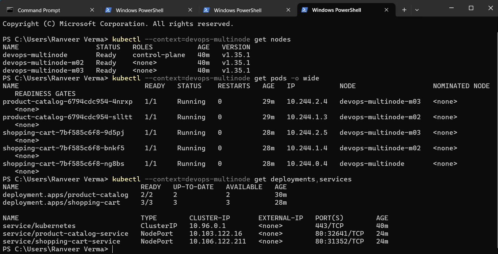
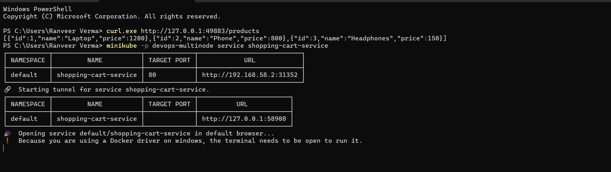
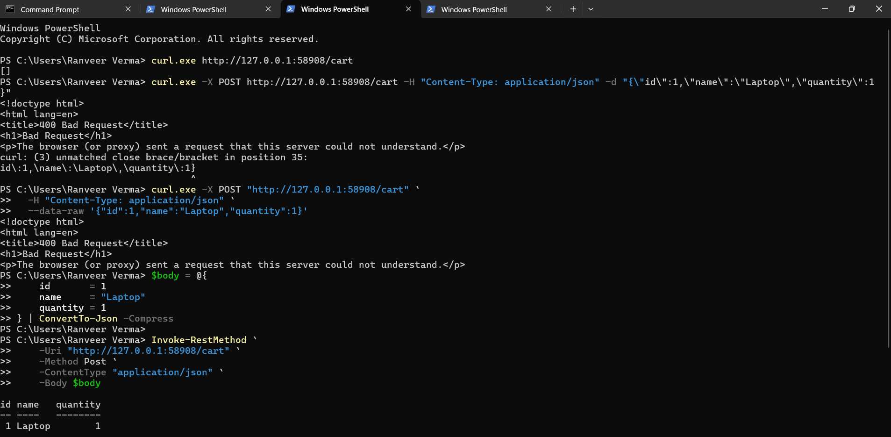
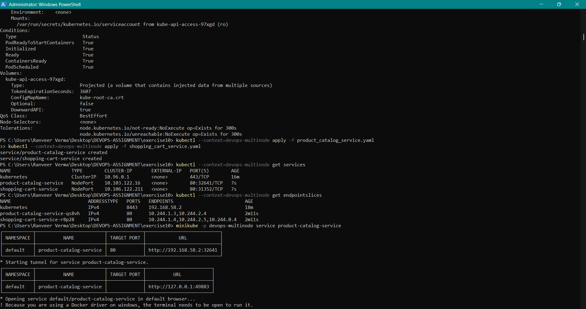

# Exercise 10: Multi-Node Kubernetes Cluster with Multiple Applications and Replicasets


### 1. Cluster and pod distribution

The captured output shows three nodes in `Ready` state. All five application pods are `Running`, with `1/1` containers ready and zero restarts.

| Node | Product Catalog pods | Shopping Cart pods |
|---|---:|---:|
| `devops-multinode` | 0 | 1 |
| `devops-multinode-m02` | 1 | 1 |
| `devops-multinode-m03` | 1 | 1 |



### 2. Product Catalog endpoint

The Product Catalog endpoint was tested through the Minikube service tunnel:

```powershell
curl.exe http://127.0.0.1:49883/products
```

The response contains Laptop, Phone, and Headphones.



### 3. Shopping Cart endpoint

The Shopping Cart GET endpoint returned an empty list initially. The POST request was successfully tested using PowerShell's `Invoke-RestMethod` with a JSON body containing a Laptop and quantity `1`.

```powershell
$body = @{
    id       = 1
    name     = "Laptop"
    quantity = 1
} | ConvertTo-Json -Compress

Invoke-RestMethod `
    -Uri "http://127.0.0.1:58908/cart" `
    -Method Post `
    -ContentType "application/json" `
    -Body $body
```

The response displayed the item fields `id`, `name`, and `quantity`.



### 4. Services and Minikube tunnels

The Services were created successfully:

- `product-catalog-service`: NodePort `32641`, target port `80`
- `shopping-cart-service`: NodePort `31352`, target port `80`

The Minikube tunnels provided these local URLs:

- Product Catalog: `http://127.0.0.1:49883`
- Shopping Cart: `http://127.0.0.1:58908`

Keep each terminal running `minikube service` open while using its local tunnel URL.

