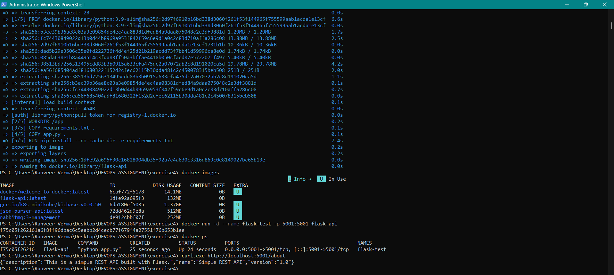
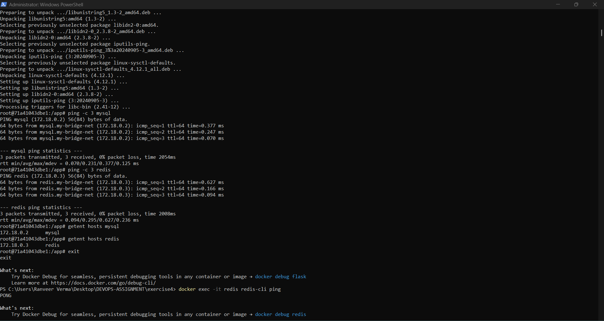
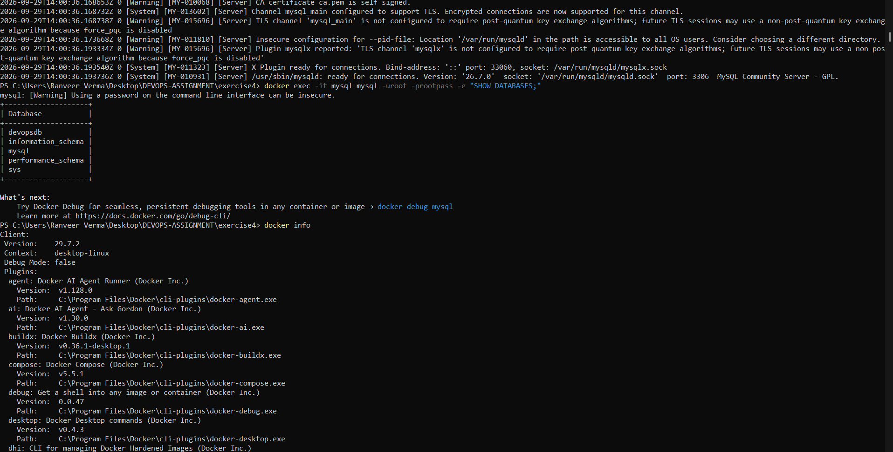
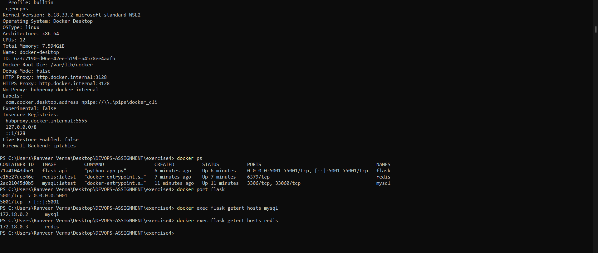

# Exercise 4 — Docker networking with multiple containers

## 1. Flask Docker Image Build and Initial API Test

The Flask application was successfully containerized and the
`flask-api` image was built successfully.

---

## 2. Container-to-Container Communication

The Flask container successfully resolved and communicated with
the MySQL and Redis containers through the `my-bridge-net`
Docker bridge network.

---

## 3. MySQL Database Verification

The MySQL container was successfully initialized with the
`devopsdb` database.

---

## 4. Final Multi-Container Configuration

The final configuration consisted of the Flask, MySQL and Redis
containers running on the same Docker bridge network.

