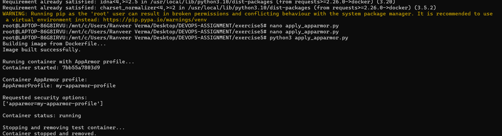
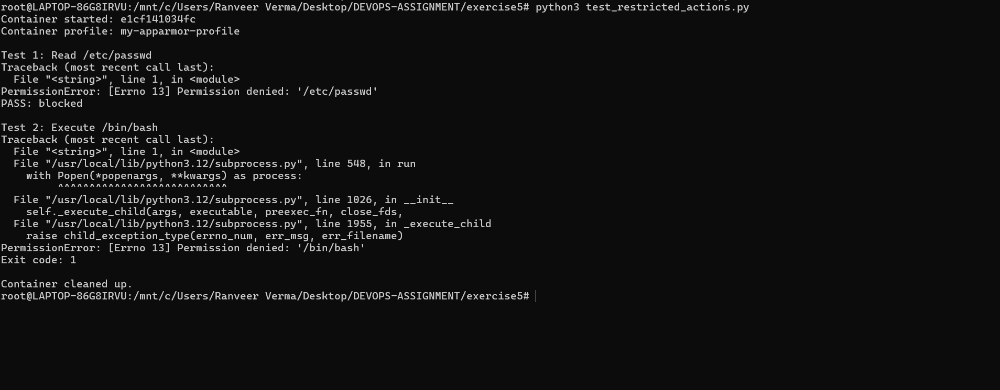
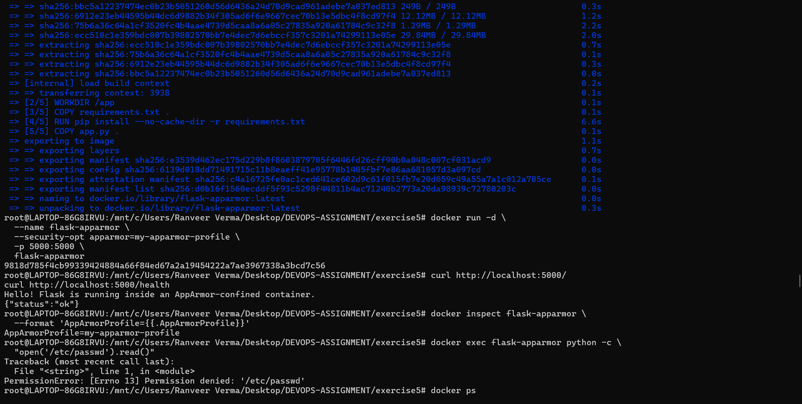

# Exercise 5 — Docker Security with AppArmor and Python
 
## 1. Applying the AppArmor Profile with the Docker SDK
 
The `flask-apparmor` image was built and the container was started with the `my-apparmor-profile` AppArmor profile using the Docker SDK for Python (`apply_apparmor.py`). The container's `AppArmorProfile` shows `my-apparmor-profile`, the requested security option is `apparmor=my-apparmor-profile`, and the container status is `running`. The script then stopped and removed the test container.
 

 
---
 
## 2. Testing Restricted Actions
 
`test_restricted_actions.py` started a container under the profile and attempted two restricted actions. Reading `/etc/passwd` failed with `PermissionError: [Errno 13] Permission denied` and was reported as `PASS: blocked`. Executing `/bin/bash` also failed with `PermissionError: [Errno 13] Permission denied` (exit code 1). The container was cleaned up afterwards.
 

 
---
 
## 3. Manual Verification with the Docker CLI
 
The image was built and run manually with `--security-opt apparmor=my-apparmor-profile`. The Flask application still responds normally: `/` returns the greeting and `/health` returns `{"status":"ok"}`. `docker inspect` confirms `AppArmorProfile=my-apparmor-profile`, and reading `/etc/passwd` from inside the running container with `docker exec` is denied with `PermissionError: [Errno 13] Permission denied`.
 
