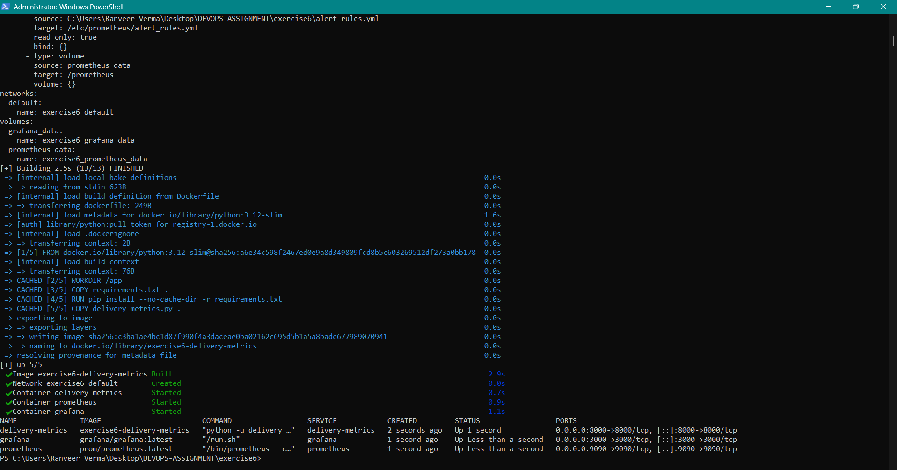
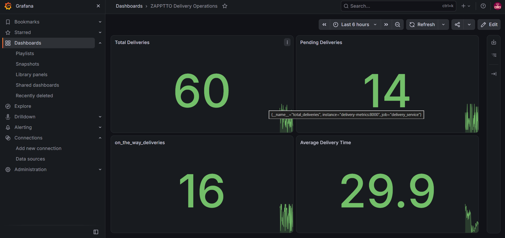
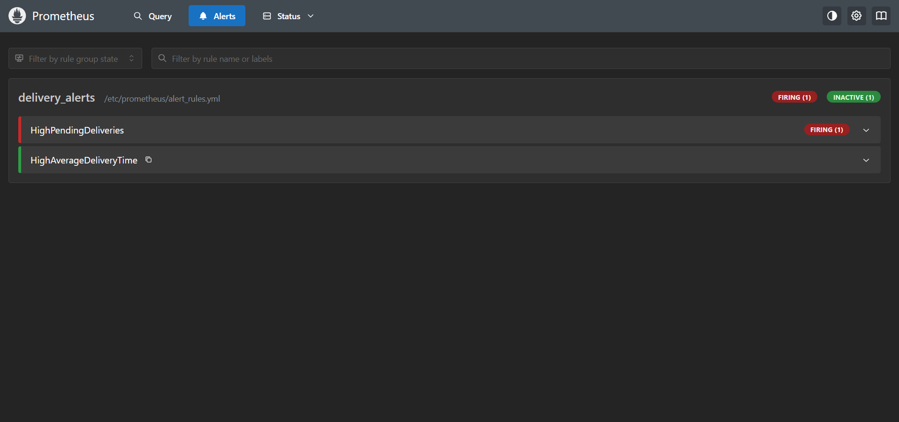

# Exercise 6 — Delivery Metrics Monitoring and Alerting

## 1. Docker Compose Service Deployment

The delivery metrics application, Prometheus, and Grafana containers were successfully built and started using Docker Compose.

---

## 2. Grafana Delivery Operations Dashboard

The Grafana dashboard displays total deliveries, pending deliveries, deliveries on the way, and average delivery time.

---

## 3. Prometheus Alert Rules Verification

Prometheus successfully loaded the delivery alert rules. The `HighPendingDeliveries` alert is firing because pending deliveries have exceeded the configured threshold.

"""