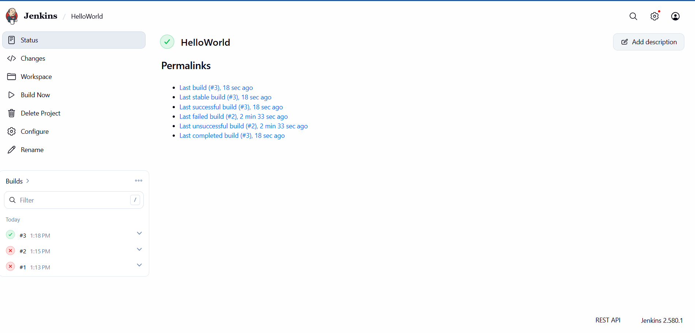
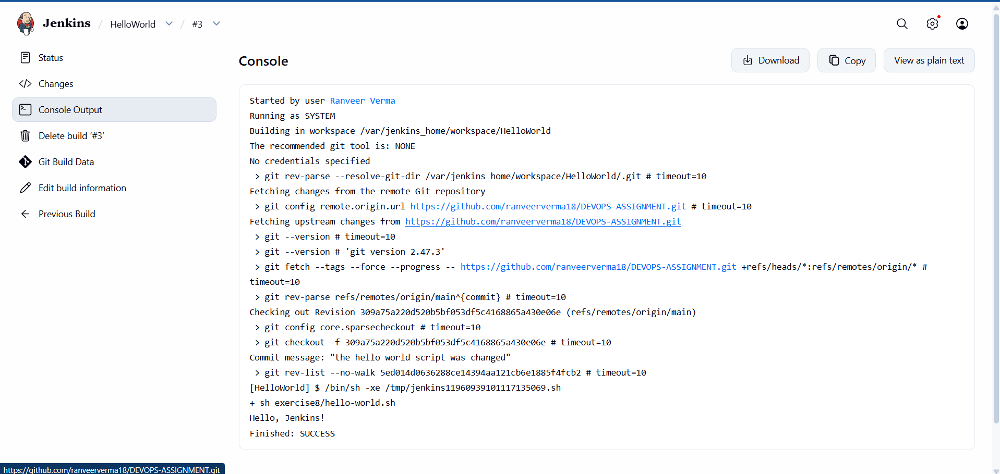

# Exercise 8 — Creating a “Hello World” Jenkins Job

## 1. Jenkins Freestyle Job

A Freestyle project named `HelloWorld` was created in Jenkins and connected to the GitHub repository `DEVOPS-ASSIGNMENT`. The job retrieves the repository's `main` branch and runs the `hello-world.sh` script from the `exercise8` directory.

---

## 2. Build Console Output

Build **#3** completed successfully. Jenkins checked out the latest code from GitHub, executed `sh exercise8/hello-world.sh`, and printed `Hello, Jenkins!` in the console.

---

## 3. Result

The Jenkins job successfully demonstrated a basic Continuous Integration workflow:

- Source code was stored in the GitHub repository.
- Jenkins retrieved the code from the `main` branch.
- The build step executed the shell script.
- The console displayed `Hello, Jenkins!` and the build finished with `SUCCESS`.