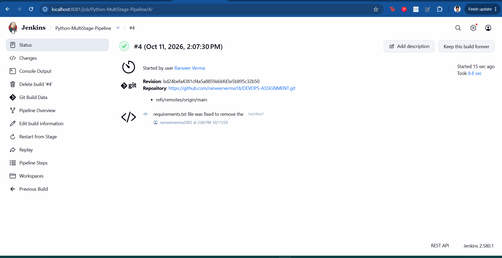
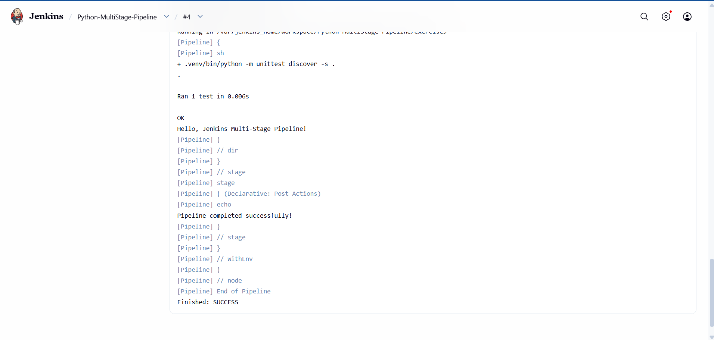

# Exercise 9: Jenkins Multi-Stage Pipeline for a Python Flask Application

## Expected Output

The application's home route (`/`) returns:

```text
Hello, Jenkins Multi-Stage Pipeline!
```

## Execution Evidence

### 1. Jenkins Build Result

The Jenkins job `Python-MultiStage-Pipeline` completed successfully. The build page shows a successful result for build **#4**.



### 2. Pipeline Console Output

The console output confirms that the test ran successfully, printed the expected response, and the pipeline finished with `SUCCESS`.



## Result

**Status: SUCCESS**

The multi-stage Jenkins pipeline completed successfully, and the Flask application's expected response was verified by the unit test.